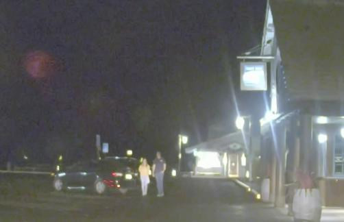
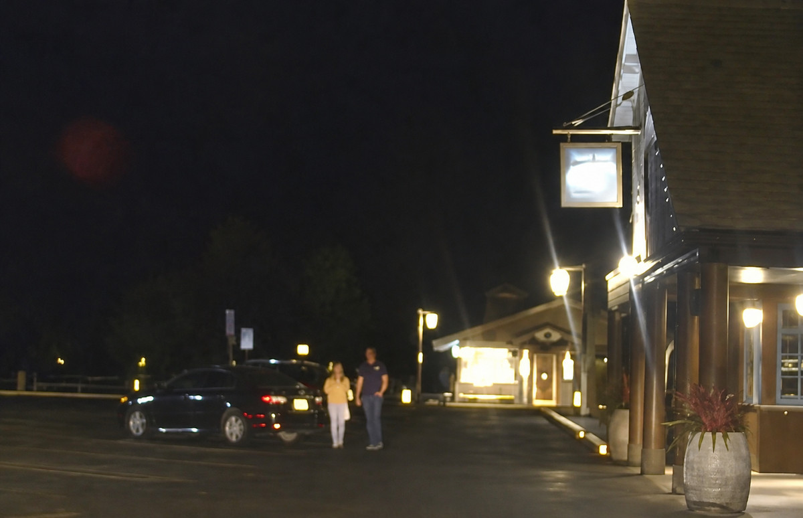

# Image Repair → Upscale

**先修复，再超分。** 一个把图像修复、文字保真与本地 EDSR 超分辨率串联起来的综合性 Codex skill。

> 本项目糅合并改编了两个开源 skill：**[pmatos/skills 的 upscale](https://github.com/pmatos/skills/tree/main/upscale)** 与 **[bosprimigenious/image-text-restore-skill](https://github.com/bosprimigenious/image-text-restore-skill)**。它是工作流与脚本的整合，不是新训练的图像模型，也不代表两个上游项目的官方合作。

The skill combines content-aware image repair and text-preserving restoration with local EDSR super-resolution. Repair first, upscale second, inspect the actual result last.

## 为什么先修复

放大错字不会把它变成正确文字，放大模糊人脸也不能确认身份。本 skill 先检查内容和布局，修复确实需要修复的区域，再对修复后的图像做神经网络超分。

```text
原图 → 检查文字、布局与局部缺陷 → 初步修复图 → EDSR 2× / 3× / 4× → 局部核对与交付
```

- **修复阶段**：错字使用明确的文字来源与真实字体重建；非文字局部缺陷使用宿主提供的图像编辑工具。内容已正确时可以跳过内容修改。
- **超分阶段**：OpenCV EDSR 本地推理，支持 2×、3×、4×及比例匹配的目标尺寸，分块处理以控制内存。
- **交付阶段**：核对实际像素尺寸、透明通道、文字、布局与局部瑕疵，保留原图和中间结果。

## 与上游的关系

| 来源 | 本项目保留与改编的部分 | 固定来源提交 |
|---|---|---|
| [pmatos/skills/upscale](https://github.com/pmatos/skills/tree/main/upscale) | `upscale_image.py`、EDSR 模型选择与分块推理 | `37e0a9889c5534a620039ed4dd38bb80c1f93d06` |
| [image-text-restore-skill](https://github.com/bosprimigenious/image-text-restore-skill) | 修复与保字流程、`enhance_raster.py`、密集图表修复参考 | `8e18928dacc6ef400b3bc1779c197fd4ab52691a` |

本地适配包括：使用 Pillow 读写以支持 Windows 中文路径、保留已有 alpha 通道、拒绝覆盖原文件与已有输出、拒绝无意的比例变形，以及区分普通锐化与真正的 EDSR 超分。两个上游均为 MIT 许可，原作者版权声明保留在 [LICENSE](LICENSE) 中。

## 安装与使用

需要 Git、[uv](https://docs.astral.sh/uv/)，以及 Codex。脚本要求 Python 3.11+；示例使用 Python 3.12。`uv` 会准备脚本的必要依赖，EDSR 对应倍率的权重在首次使用时下载到本地缓存，不随仓库分发。

Windows PowerShell：

```powershell
git clone https://github.com/GuoruiC/image-repair-upscale.git "$env:USERPROFILE\.codex\skills\image-repair-upscale"
```

macOS / Linux：

```bash
git clone https://github.com/GuoruiC/image-repair-upscale.git ~/.codex/skills/image-repair-upscale
```

在下一轮对话中使用；若宿主未刷新 skill 列表，重启宿主。附上图片后，例如：

```text
用 $image-repair-upscale 先修复这张图，再放大到 4K，保留文字、布局和已有透明通道。
```

单独对已修复的图片运行本地超分：

```powershell
uv run --python 3.12 --script ./scripts/upscale_image.py ./repaired.png --factor 2 --output ./upscaled-2x.png
uv run --python 3.12 --script ./scripts/upscale_image.py ./repaired.png --factor 4 --output ./upscaled-4x.png
```

精确尺寸用 `--size WIDTHxHEIGHT`；目标应保持源图比例。`--dry-run` 只检查计划，`--keep-raw` 保留最终尺寸调整前的 EDSR 输出。大图可以调整 `--tile-size` 和 `--overlap`。

超分脚本无需图像 API 密钥。局部生成式修复需要宿主的图像编辑能力；本项目没有把普通 Pillow 锐化冒充成自动语义修复。

## 夜景测试案例

以下是示例提供者明确授权本次公开的实际测试。输入是一张低分辨率夜景照片，先通过宿主内置图像编辑生成初步修复图，再分别运行本地 **EDSR_x2** 和 **EDSR_x4**。2×与4×都以同一张初步修复图为输入，不是连续串联两次放大。

| 阶段 | 实际尺寸 | 方法 |
|---|---|---|
| 原图 | 502 × 324 | 原始测试输入，保持不变 |
| 初步修复 | 1561 × 1007 | 内置图像编辑修复噪点和雾感，保留主要构图 |
| 2× | 3122 × 2014 | 对初步修复图运行 EDSR_x2 |
| 4× | 6244 × 4028 | 对初步修复图运行 EDSR_x4 |

这里的“4×”是宽、高各放大4倍，不等于“4K”；这张4×图的宽度是6244像素。README 使用缩小的 JPEG 预览以方便浏览，点击图片可打开对应的完整 PNG。

<table>
  <tr>
    <td><strong>原图 · 502 × 324</strong><br><a href="examples/night-street/original.png"></a></td>
    <td><strong>初步修复 · 1561 × 1007</strong><br><a href="examples/night-street/initial-repair.png"></a></td>
  </tr>
  <tr>
    <td><strong>2× EDSR · 3122 × 2014</strong><br><a href="examples/night-street/upscaled-2x.png"></a></td>
    <td><strong>4× EDSR · 6244 × 4028</strong><br><a href="examples/night-street/upscaled-4x.png"></a></td>
  </tr>
</table>

完整图片：[原图](examples/night-street/original.png) · [初步修复](examples/night-street/initial-repair.png) · [2×](examples/night-street/upscaled-2x.png) · [4×](examples/night-street/upscaled-4x.png)。

查看[本次修复提示词](examples/night-street/repair-prompt.txt)与[尺寸、哈希和方法记录](examples/night-street/manifest.json)。

**案例边界：**原图是完全不透明的 RGB PNG，因此本案例保留完整夜景，没有移除背景。原本不可辨读的招牌和人脸仍不具有可靠可辨读信息。生成式修复及超分产生的是可能合理的细节，不能作为原始事实恢复的证据。这个案例展示流程和实际输出，不是模型效果排名或准确性基准。

## 检查与限制

验证脚本可在临时测试图上检查真实 EDSR 推理、中文路径、alpha 保留、尺寸与文件保护：

```powershell
uv run --python 3.12 --script ./tests/test_pipeline.py
```

- 透明 RGB 内容由 EDSR 处理，alpha 蒙版采用确定性缩放；透明输入要求 PNG 输出。
- 只增加像素不能修正错字、识别模糊身份、恢复不存在的信息，或解决图表排版拥挤。
- 文字密集的科研图应优先核对并重建文字层，超分后再次检查公式、数值、标签与箭头。
- 本地 CPU 推理耗时随图片尺寸与硬件而变化；本项目不承诺特定速度。
- 目标超过选定神经网络输出范围会被拒绝，不会把额外插值放大称作新的神经细节恢复。
- `enhance_raster.py` 是保守的常规放大与锐化工具，不能替代内容修复或神经网络超分。

## 文件结构

```text
SKILL.md                      主工作流
agents/openai.yaml            Codex 界面信息
scripts/upscale_image.py      EDSR 超分与尺寸验证
scripts/enhance_raster.py     可选常规增强基线
references/diagram-restoration.md
tests/test_pipeline.py        可运行的功能检查
examples/night-street/        授权公开的初步、2×、4×案例
```

代码与改编文档使用 [MIT License](LICENSE)。示例图片由提供者授权本次公开展示；代码的 MIT 许可不自动扩展为示例照片的再许可。
