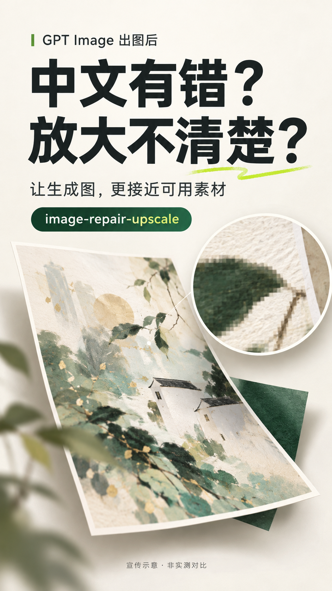
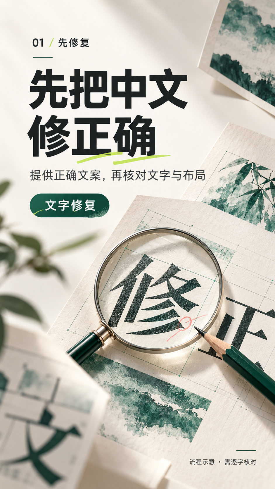
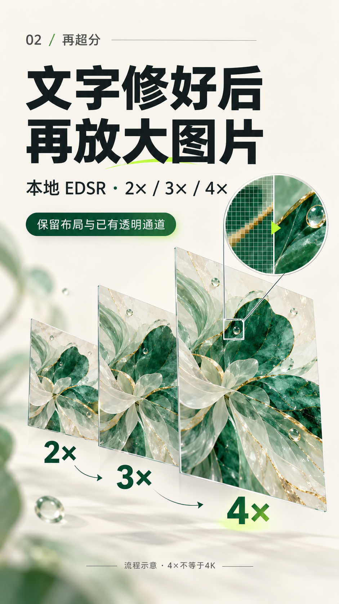
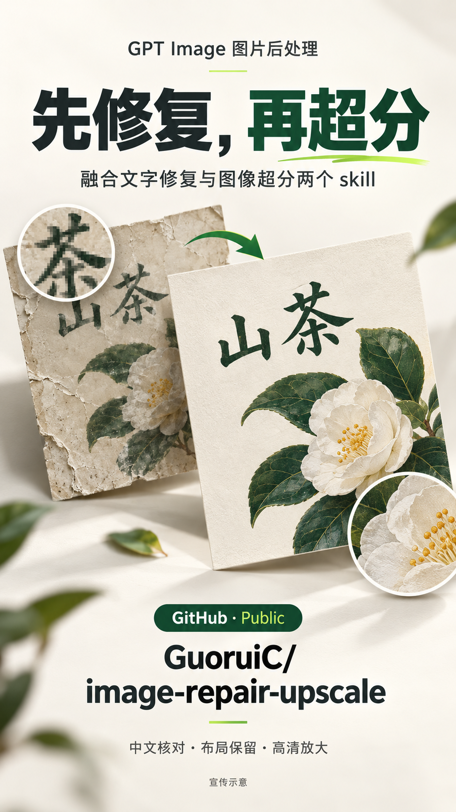

# 宣传视频图片

为 `image-repair-upscale` 制作的四张竖版静帧，面向小红书和抖音的视频介绍。实际文件均为 **941 × 1672 像素的 PNG**，比例接近 9:16。导入 1080 × 1920 的竖屏剪辑项目时请等比例缩放，并检查平台按钮、字幕是否遮挡文字。

可按下列顺序播放，配合轻微推近和配音；下列时长仅为剪辑建议。

| 顺序 | 图片 | 建议时长 | 配音建议 |
|---|---|---|---|
| 1 | [痛点与封面](01-pain-point.png) | 0–5 秒 | GPT Image 生成的图很好看，但中文有时会出错，放大使用也可能不够清楚。 |
| 2 | [先修复中文](02-text-repair.png) | 5–10 秒 | 这个 skill 先根据正确文案修复中文，再核对文字和原有布局。 |
| 3 | [再做超分](03-super-resolution.png) | 10–16 秒 | 文字核对后，再用本地 EDSR 做两倍、三倍或四倍放大，最后检查细节。 |
| 4 | [项目入口](04-project-entry.png) | 16–22 秒 | 我把文字修复和图像超分两个开源 skill 融合成了一个工作流，已在 GitHub 公开。 |

这些图由宿主内置图像生成工具制作，是宣传与流程示意，不是实测前后对比。图中的抽象图像和字体设计不用于证明修复成功；实际超分记录见仓库的夜景案例。现有夜景案例并未测试 GPT Image 中文纠错。

提示词见 [prompts.md](prompts.md)。项目入口：[GuoruiC/image-repair-upscale](https://github.com/GuoruiC/image-repair-upscale)。
